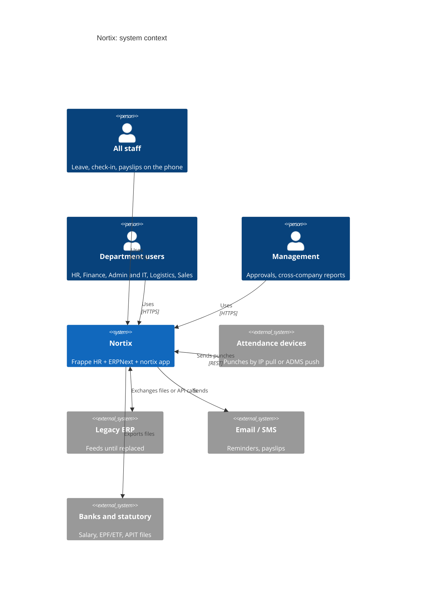
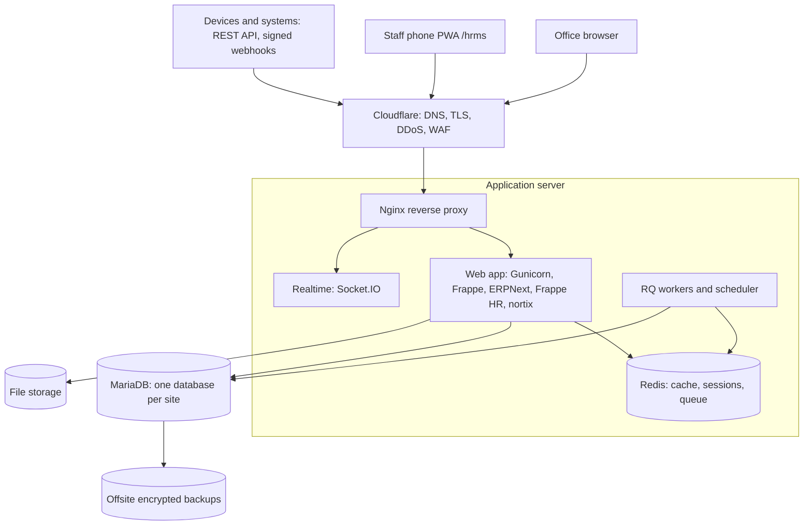

# Architecture Overview

Nortix is a modular monolith: one Frappe application server per deployment, one database per customer site, and one custom app (`nortix`) on top of Frappe HR and ERPNext. Outside systems connect only through the REST API.

## Context (C4 level 1)

## Containers (C4 level 2)

## Modules (C4 level 3, inside `nortix`)

| Module | Workspace | Builds on | Owns |
| --- | --- | --- | --- |
| `hr_leave` | HR | Frappe HR Leave | Leave settings, quarter allocation job, alerts, Sheet import |
| `hr_attendance` | HR | Employee Checkin | Office-network check-in rule, device sync config |
| `localisation/lk` | HR, Finance | Payroll | EPF, ETF, APIT components, return files |
| `admin_assets` | Admin and IT | ERPNext Asset | Issued Item register, exit checklist links |
| `admin_renewals` | Admin and IT, Finance | Notifications | Renewal register and reminders |
| `it_network` | Admin and IT | Helpdesk | Network device and IP register |
| `finance_office` | Finance | ERPNext Accounts | Petty cash, cheque and bill reports |
| `core` | All | Frappe | Roles, workspaces, shared utilities, settings |

Module rules: a module may call another module only through its `services` functions; no module reads another module's tables directly.

## Key decisions
See [adr/](adr/): platform (0001), site per customer (0002), no core edits (0003), configuration over code (0004), localisation module (0005), white-label branding (0006).
