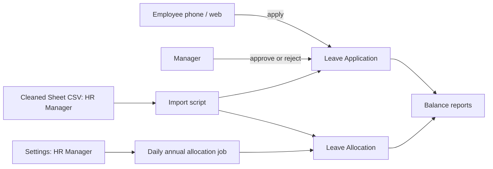

# Threat Model: Leave (R1)

## Scope
Leave Application, Leave Allocation, Nortix Leave Settings, annual allocation job, Sheet import, Frappe HR PWA.

## Assets
Leave balances and history; employee personal data; settings that drive entitlements.

## Data flow

## Threats

| ID | Category | Threat | Mitigation | Test |
| --- | --- | --- | --- | --- |
| T1 | Spoofing | Someone applies leave as another employee | Employee linked to the logged-in user; server sets employee from session for Employee role | Employee cannot create an application for another employee |
| T2 | Tampering | Employee edits an approved application to change dates | Submitted documents read-only; changes by cancel and amend with approval | Edit of submitted record rejected |
| T3 | Tampering | HR user changes settings to grant extra leave unnoticed, or an HR Manager of one company changes rules that apply to every company | Settings change history on; settings editable by System Manager only, HR Manager and HR User read only (2026-11-11, product owner); weekly change report | Change creates Version record; company-limited HR Manager cannot save settings |
| T4 | Repudiation | Approver denies approving | Workflow records approver and time | Approval logged in Version and comments |
| T5 | Disclosure | HR user of Company A sees Company B data via report or API | User Permissions on Company; report queries permission-aware | Isolation test across form, list, report, API, export |
| T6 | Disclosure | Personal data leaks through import or job error logs | Import error reports contain row number and field name only; the annual allocation job logs employee ID, leave period and error type only | Review of error output; failed-allocation log contains no employee name |
| T7 | Elevation | Employee approves own leave | Leave approver cannot equal applicant | Self-approval rejected |
| T8 | Denial of service | Bulk import blocks the site | Import runs as background job in batches | Large-file test on staging |
| T9 | Integrity | Allocation job runs twice and doubles leave | Skip any employee with an allocation for (employee, leave type, period); run lock so a second run stops; Frappe HR rejects overlapping allocations | Double run creates one allocation; run during a held lock creates none |
| T10 | Tampering | User sets the source field on an allocation or adjustment to suppress an employee's leave or disguise a manual change as automatic | Server rejects `nortix_source` on Leave Allocation and Leave Adjustment unless set by the jobs or the import | HR user cannot set the source through the API on either |
| T11 | Integrity | An HR adjustment on a casual allocation silently stops, or is overwritten by, the 1-year casual rise | Only the job's own adjustment counts as done; an existing submitted HR adjustment is left alone and the employee is logged for HR review; a draft does not block | HR adjustment reported, not overridden; draft does not block |

## Residual risks
Shared phones where staff stay logged in: mitigated by session expiry and user guidance; accepted for R1, review at R2.
